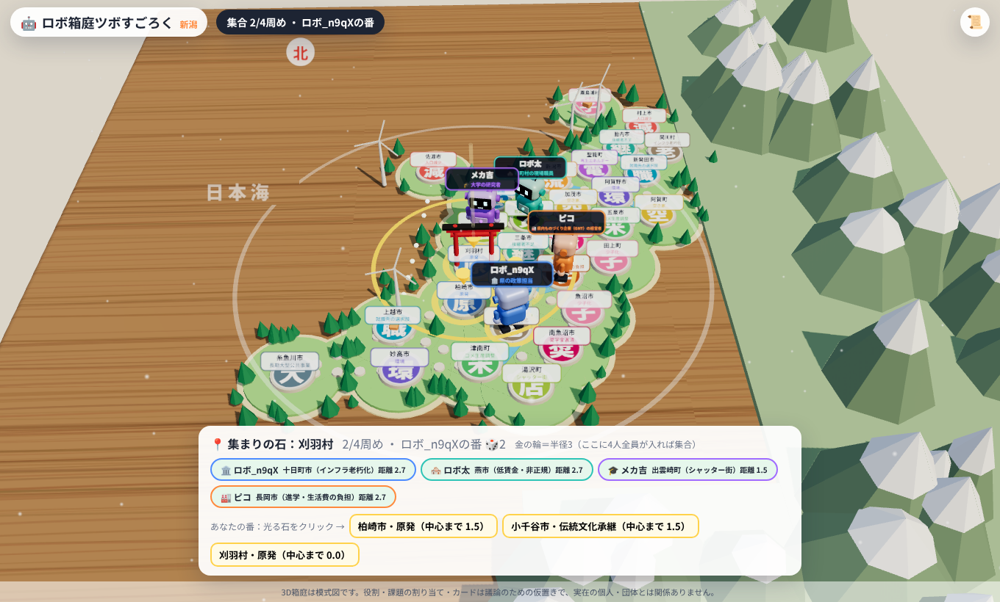

# ロボ箱庭ツボすごろく 新潟 (tsubomap-niigata-sugoroku)

新潟県の30市町村が **石畳** として並ぶ3D箱庭（three.js）の上を、地域課題のステークホルダーになったミニロボットが歩き、
**4体が半径3以内に集まった立ち位置＝複合的な課題のお題** を決め、AI審査員（鬼審査員ロボ）と議論しながら、斬新なアイデアと変革実行プランを磨くゲームです。

[keith-river/robo-sugoroku](https://github.com/keith-river/robo-sugoroku)（ミニロボットの双六ゲーム, MIT）をベースに、UIとゲームの中身を作り替えた派生版です。



## 遊び方

1. **ロビー**：名前と役割（8種）を選ぶ。CPUを足して2〜4体にする。石の課題は「初期設定」か「ランダム」。
2. **集合（4周）**：ロボットは集まりの石から半径7以内にランダムに降り立つ。自分の番にサイコロ（1〜3）を振り、光った石をクリックして移動。
   4周のうちに全員が半径3の金の輪に入る（輪の外にいる人は、4周目の終わりに磁力で引き寄せられる）。
3. **お題**：4人の足元の課題（例「原発 × 後継者不足 × 伝統文化承継」）が1つの問いに束ねられる。
4. **討論**：順番に提案→鬼審査員が欠点を指摘→プレイヤーが論理で答え、他の3人の心に響く一言を書く（ナッジ）→改訂、を繰り返す。
   手札（武器・防具カード）は1回に最大2枚まで使える。使い方を書かないと「使った」とは見なされない。
5. **結果**：最終案、初案からの伸び、記録のMarkdown保存。

武器・防具カードは78枚：ナッジ34、Job理論8、破壊的イノベーション9、MBAツール27（`public/data/tools.js`）。主要なものを集めた一覧で、網羅的ではありません。定義は原典で確認してください。

## 起動

Node.js 18 以上。

```bash
npm install
node server.js          # http://localhost:3000   （PORT=3200 で変更）
npm test
```

### AI審査員（任意）

| 環境変数 | 意味 |
|---|---|
| `ANTHROPIC_API_KEY` | 設定すると、LLM（Anthropic Messages API）が審査する。キーはサーバだけで使いブラウザには送らない |
| `ANTHROPIC_MODEL` | 既定 `claude-sonnet-5-5` |
| `ANTHROPIC_API_URL` | 既定 `https://api.anthropic.com/v1/messages` |
| `CRITIC_TIMEOUT_MS` | LLM応答の待ち時間。超えるとルールベースに切り替わる |
| `WRITE_TIMEOUT_MS` / `MOVE_TIMEOUT_MS` | 記入・移動の制限時間（超えるとCPUが代筆・代行） |
| `SPEED` | 演出の速さ（小さいほど速い。テスト用） |

キー未設定時は **ルールベース審査** で動きます。

## 構成

- `game.js` ゲーム進行（サーバ主導。集合・お題・討論・得点）
- `critic.js` 審査員（LLM／ルールベース）、CPUの代筆
- `server.js` Express + Socket.io
- `public/scene.js` 3D箱庭、`public/robot.js` ロボット、`public/main.js` UI
- `public/data/` 市町村・課題・役割・カード（ブラウザとサーバで共有）

## 限界（必ずお読みください）

- **課題の初期割り当て・隣接関係・課題どうしのつながり**は、公開情報をもとにした **定性的な仮置き** で、統計に基づくものではありません。地図は模式図で、実際の位置・面積とは異なります。
- **役割カードは架空の典型像** で、実在の個人・団体・企業とは関係ありません（「GNT」は表示上の名称です）。
- **ルールベース審査** は文章の意味を理解せず、ジョブ・数値・期間・ナッジの語・関係者への言及などの **有無** を見ます。点数は議論の磨き込みの目安で、案の正しさや効果の予測ではありません。LLM審査は、この環境では実キーで動作確認していません。
- 得られた案は議論の素材です。数値や効果は仮置きで、実行前に実データと関係者で検証してください。

## ライセンス

MIT。元リポジトリ（Copyright (c) 2026 keith-river）の著作権表示とライセンス文を `license.txt` に保持しています。
本派生版のうち、`game.js` `critic.js` `server.js` `public/` の新規部分は Claude（Anthropic）が生成したコードを含みます。
ロボットのモデル・サイコロ・パーティクル等の描画処理は元の `scene.js` を元にしています。three.js は `public/vendor/three/` に同梱（MIT, `LICENSE`参照）。
